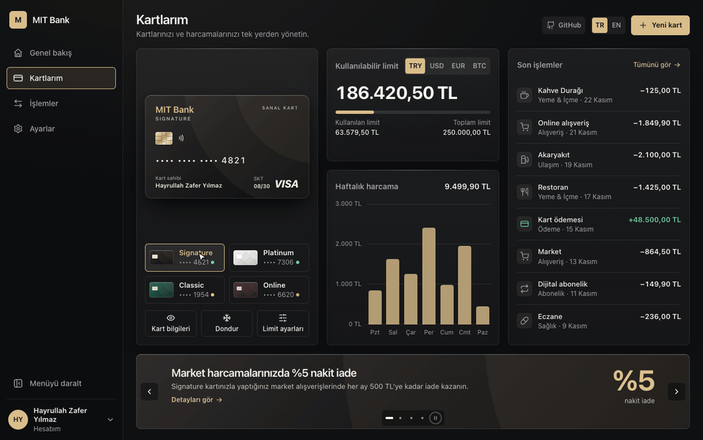

# Bank Cards

A responsive bank card screen built with Vue 3 and TypeScript, available in Turkish and English. The selected virtual card sits in a three-column dashboard next to the available limit, weekly spending and recent transactions. Click it to turn it over and see its number, expiry date and CVV. When you switch cards, [shatter-morph](https://www.npmjs.com/package/shatter-morph) breaks it into solid shards that swirl around the panel and rebuild as the next card.

[Türkçe](docs/README.tr.md)



## Features

- **Turkish and English:** a switch at the top of the page changes every label, amount and date, and the browser remembers the choice.
- **Two-sided virtual card:** click the card to turn it over and see its number, expiry date and CVV.
- **Shard transition:** powered by `shatter-morph` and its WebGL renderer. The card breaks into hundreds of thick, lit 3D pieces, flows around a vortex and forms the next card.
- **Account panels:** available limit, a weekly spending chart, recent transactions and a currency selector that uses sample rates. Changing the currency turns the balance over tile by tile with the `flip` motion.
- **Offer carousel:** a full-width carousel under the panels. Slides change with the `flip` motion and support autoplay with a progress ring, pause, arrows, dots, the keyboard and swipe. Autoplay waits while the carousel is off screen.
- **Side menu:** collapses to icons on desktop and remembers the choice. Only My cards is active. The other menu items and the New card, Freeze, Limit settings and View all controls are visual.
- **Reusable components:** the card, stage, summary, weekly chart, transactions, picker and currency selector work independently and are driven by props.
- **Card types and states:** credit, debit and prepaid cards that can be active, frozen or expired.
- **Responsive layout:** a side menu with three columns on desktop, and a top menu with stacked panels on tablets and phones, sized with `rem`, `em`, `%`, `cqw`, `vw` and `svh`.
- **Accessible by default:** keyboard selection, translated screen reader labels and an instant card change when reduced motion is on.
- **Lightweight:** no Three.js or i18n library, and about 63 KB of gzipped JavaScript.

## Tech stack

Vue 3, TypeScript, Vite, Tailwind CSS 4, shatter-morph and Prettier.

## Getting started

You need Node.js 20.19+ or 22.12+.

```bash
git clone <repository-url>
cd bank-cards
npm install
npm run dev
```

Open the local URL printed in the terminal.

## Scripts

| Command                  | Description                           |
| ------------------------ | ------------------------------------- |
| `npm run dev`            | Starts the development server         |
| `npm run build`          | Type-checks and builds for production |
| `npm run preview`        | Serves the production build locally   |
| `npm run prettier`       | Formats the whole project             |
| `npm run prettier:check` | Checks formatting without writing     |

## Project structure

```text
src/
├── components/
│   ├── bank-card/
│   │   ├── BankCard.vue          Standalone card
│   │   ├── CardBack.vue          Card details and CVV
│   │   ├── CardFront.vue         Card front face
│   │   ├── CardPicker.vue        Card list with v-model
│   │   ├── CardStage.vue         Selected card with flip
│   │   ├── CardSummary.vue       Balance and limit
│   │   ├── CardTransactions.vue  Recent transactions
│   │   ├── CardWeeklySpend.vue   Weekly spending chart
│   │   ├── CurrencySelector.vue  Display currency with v-model
│   │   └── index.ts              Public exports
│   ├── layout/                   Side menu and language switch
│   ├── promo/                    Offer carousel and slide
│   └── ui/                       Shared panel, button, icon, progress ring and segmented control
├── composables/                  Card morph, flip, tilt, side menu, carousel and visibility
├── constants/                    Card labels, sample rates, icons, menu and shatter motions
├── data/                         Sample cards and offers
├── i18n/                         Turkish and English messages
├── styles/main.css               Tailwind theme and card utilities
├── types/                        Card and offer types
├── utils/                        Formatting, motion and storage helpers
└── views/CardsView.vue           Card dashboard
```

## Usage

```vue
<script setup lang="ts">
import { computed, ref } from 'vue'
import { CardPicker, CardStage, CardSummary } from '@/components/bank-card'
import { customerCards } from '@/data/cards'
import type { CurrencyCode } from '@/types/card'

const selectedId = ref(customerCards[0]?.id ?? '')
const currency = ref<CurrencyCode>('TRY')
const selectedCard = computed(() => customerCards.find((card) => card.id === selectedId.value))
</script>

<template>
  <template v-if="selectedCard">
    <CardStage :card="selectedCard" />
    <CardSummary :card="selectedCard" :currency="currency" />
    <CardPicker v-model="selectedId" :cards="customerCards" />
  </template>
</template>
```

`BankCard` can also be used on its own:

```vue
<BankCard
  :card="card"
  size="lg"
  pose="angled"
  selectable
  :selected="card.id === selectedId"
  @select="selectedId = $event"
/>
```

| Prop         | Type                      | Default  | Description                         |
| ------------ | ------------------------- | -------- | ----------------------------------- |
| `card`       | `BankCardFace`            | Required | Card shown on the face              |
| `size`       | `sm`, `md`, `lg`, `fluid` | `md`     | Maximum card width                  |
| `pose`       | `flat`, `angled`, `hero`  | `flat`   | Resting angle                       |
| `side`       | `front`, `back`           | `front`  | Card face to show                   |
| `tilt`       | `boolean`                 | `true`   | Follows the pointer                 |
| `selectable` | `boolean`                 | `false`  | Renders the card as a button        |
| `selected`   | `boolean`                 | `false`  | Shows the selected state            |
| `logoSrc`    | `string`                  | None     | Logo image used instead of the name |

Use the `logo` slot for a custom logo. A selectable card emits `select` with its `id`.

## Card transition

`CardStage` wraps the card in the `Shatter` component from `shatter-morph`, which plays whenever `value` changes:

```vue
<script setup lang="ts">
import { Shatter } from 'shatter-morph/vue'
import { solidShards } from 'shatter-morph/solid'

const options = {
  motion: 'vortex',
  duration: 2800,
  renderer: solidShards,
  cracks: false,
}
</script>

<template>
  <Shatter :value="card.id" :options="options">
    <BankCard :card="card" size="fluid" />
  </Shatter>
</template>
```

The shards are cut from the card's real shape and can fly past the panel, over the rest of the page. `useMorphTracker` only tracks the flight, so the card stops following the pointer while the shards move. `useCardFlip` turns the card over and returns it to the front when another card is selected.

## Languages

The interface is available in Turkish and English. Turkish is the default, and the language selected at the top of the page is saved in the browser.

Messages live in `src/i18n/tr.ts` and `src/i18n/en.ts`. Both follow the `Messages` type, so a missing translation fails the type check. Read them in any component with `useI18n`:

```vue
<script setup lang="ts">
import { useI18n } from '@/i18n'

const { locale, t } = useI18n()
</script>

<template>
  <h1>{{ t.page.title }}</h1>
  <button type="button" @click="locale = 'en'">English</button>
</template>
```

To add a language, create its messages file, then add it to `Locale` in `src/i18n/types.ts` and to `LOCALE_NAMES` and `MESSAGES` in `src/i18n/index.ts`.

## Card data

Sample cards live in `src/data/cards.ts`:

```ts
const card: BankCardData = {
  id: 'card-1',
  bankName: 'MIT Bank',
  holderName: 'Hayrullah Zafer Yılmaz',
  productName: 'Signature',
  kind: 'credit',
  network: 'visa',
  last4: '4821',
  cvv: '482',
  expiry: { month: 8, year: 2030 },
  status: 'active',
  theme: 'obsidian',
  contactless: true,
  currency: 'TRY',
  limitMinor: 25_000_000,
  availableMinor: 18_642_050,
  transactions: [{ id: 't-11', type: 'cafe', date: '2026-11-22', amountMinor: -12_500 }],
  weeklySpendMinor: [85_000, 162_500, 125_000, 240_000, 97_500, 194_990, 45_000],
}
```

Amounts use minor units, so `25_000_000` is 250,000.00 TL. Debit and prepaid cards use `balanceMinor` instead of the two limit fields. A transaction's title and category come from the language files through its `type`. `weeklySpendMinor` holds seven daily totals from Monday to Sunday.

## Customization

- **Transitions:** change `motion`, `duration`, `spread`, `shards` or `edgeColor` in `src/constants/shatter.ts`.
- **New theme:** add it to `CardTheme`, `src/styles/main.css` and `cardStyles.ts`.
- **Layout:** `CardsView.vue` places the panels with a Tailwind grid, so columns and rows can be changed there.

## Notes

- This project uses sample data and has no backend. The bank, card details and exchange rates are fictional.
- Cards store only the last four digits. Do not keep full card numbers or security codes in frontend code.
- The Visa, Mastercard and Troy marks are simplified placeholders. Replace them with official assets and follow each brand's guidelines before using this in a real product.

## License

[MIT](LICENSE)
