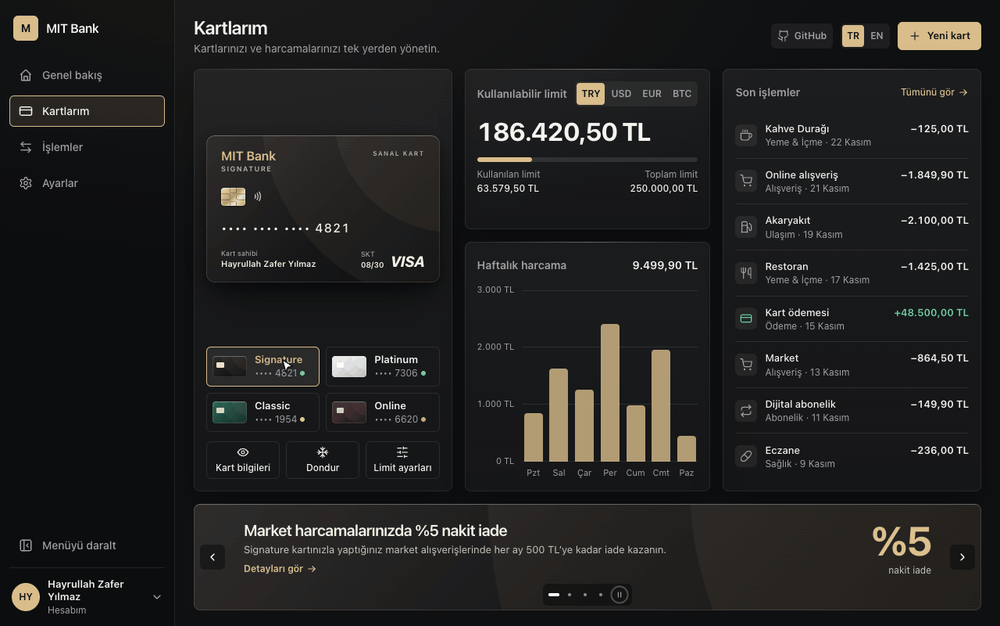

# Bank Cards

Vue 3 ve TypeScript ile geliştirilmiş, Türkçe ve İngilizce kullanılabilen responsive bir banka kartı ekranı. Seçili sanal kart; kullanılabilir limit, haftalık harcama ve son işlemler panelleriyle üç sütunlu bir ekranda durur. Karta tıkladığınızda döner, numarasını, son kullanma tarihini ve CVV'sini görürsünüz. Kart değiştirdiğinizde [shatter-morph](https://www.npmjs.com/package/shatter-morph) kartı katı parçalara ayırır, parçalar panel içinde döner ve yeni kart olarak yeniden birleşir.

[English](../README.md)



## Özellikler

- **Türkçe ve İngilizce:** sayfanın üstündeki seçici tüm metinleri, tutarları ve tarihleri değiştirir. Seçim tarayıcıda hatırlanır.
- **Çift yüzlü sanal kart:** karta tıklayınca döner; numara, son kullanma tarihi ve CVV görünür.
- **Parçalı geçiş:** `shatter-morph` ve WebGL çizicisiyle çalışır. Kart yüzlerce kalın ve ışıklı 3D parçaya ayrılır, bir girdap boyunca akar ve yeni kartı oluşturur.
- **Hesap panelleri:** kullanılabilir limit, haftalık harcama grafiği, son işlemler ve örnek kurlarla çalışan para birimi seçici. Para birimi değişince bakiye `flip` hareketiyle karo karo döner.
- **Kampanya carousel'i:** panellerin altında tam genişlikte durur. Slaytlar `flip` hareketiyle değişir, ilerleme halkalı otomatik geçiş, durdurma, oklar, noktalar, klavye ve kaydırma desteği vardır. Carousel ekran dışındayken otomatik geçiş bekler.
- **Yan menü:** masaüstünde ikonlara daralır ve seçim hatırlanır. Yalnızca Kartlarım aktiftir. Diğer menü öğeleri ile Yeni kart, Dondur, Limit ayarları ve Tümünü gör kontrolleri görseldir.
- **Tekrar kullanılabilir bileşenler:** kart, sahne, özet, haftalık grafik, işlemler, kart seçici ve para birimi seçici bağımsız çalışır ve props ile yönetilir.
- **Kart türleri ve durumları:** aktif, dondurulmuş veya süresi dolmuş olabilen kredi, banka ve ön ödemeli kartlar.
- **Responsive yerleşim:** masaüstünde yan menü ve üç sütun, tablet ve telefonda üst menü ve alt alta paneller. Ölçüler `rem`, `em`, `%`, `cqw`, `vw` ve `svh` ile yazılmıştır.
- **Erişilebilirlik:** klavyeyle seçim, çevrilmiş ekran okuyucu etiketleri ve hareket azaltma açıkken anında kart değişimi.
- **Hafif:** Three.js veya i18n kütüphanesi yok, gzip ile yaklaşık 63 KB JavaScript.

## Teknolojiler

Vue 3, TypeScript, Vite, Tailwind CSS 4, shatter-morph ve Prettier.

## Kurulum

Node.js 20.19+ veya 22.12+ sürümü gerekir.

```bash
git clone <repository-url>
cd bank-cards
npm install
npm run dev
```

Terminalde görünen yerel adresi tarayıcıda açın.

## Komutlar

| Komut                    | Açıklama                                      |
| ------------------------ | --------------------------------------------- |
| `npm run dev`            | Geliştirme sunucusunu başlatır                |
| `npm run build`          | Tip kontrolü yapar ve production çıktısı alır |
| `npm run preview`        | Production çıktısını yerelde açar             |
| `npm run prettier`       | Tüm projeyi formatlar                         |
| `npm run prettier:check` | Dosyaları değiştirmeden formatı kontrol eder  |

## Proje yapısı

```text
src/
├── components/
│   ├── bank-card/
│   │   ├── BankCard.vue          Bağımsız kart
│   │   ├── CardBack.vue          Kart bilgileri ve CVV
│   │   ├── CardFront.vue         Kartın ön yüzü
│   │   ├── CardPicker.vue        v-model destekli kart listesi
│   │   ├── CardStage.vue         Dönen seçili kart
│   │   ├── CardSummary.vue       Bakiye ve limit
│   │   ├── CardTransactions.vue  Son işlemler
│   │   ├── CardWeeklySpend.vue   Haftalık harcama grafiği
│   │   ├── CurrencySelector.vue  v-model destekli para birimi
│   │   └── index.ts              Dışa açılan bileşenler
│   ├── layout/                   Yan menü ve dil seçici
│   ├── promo/                    Kampanya carousel'i ve slayt
│   └── ui/                       Ortak panel, buton, ikon, ilerleme halkası ve seçim kontrolü
├── composables/                  Kart geçişi, döndürme, eğim, yan menü, carousel ve görünürlük
├── constants/                    Kart etiketleri, örnek kurlar, ikonlar, menü ve shatter hareketleri
├── data/                         Örnek kartlar ve kampanyalar
├── i18n/                         Türkçe ve İngilizce metinler
├── styles/main.css               Tailwind teması ve kart stilleri
├── types/                        Kart ve kampanya tipleri
├── utils/                        Biçimlendirme, hareket ve depolama yardımcıları
└── views/CardsView.vue           Kart ekranı
```

## Kullanım

```vue
<script setup lang="ts">
import { computed, ref } from 'vue'
import { CardPicker, CardStage, CardSummary } from '@/components/bank-card'
import { customerCards } from '@/data/cards'
import type { CurrencyCode } from '@/types/card'

const selectedId = ref(customerCards[0]?.id ?? '')
const currency = ref<CurrencyCode>('TRY')
const selectedCard = computed(() => customerCards.find((card) => card.id === selectedId.value))
</script>

<template>
  <template v-if="selectedCard">
    <CardStage :card="selectedCard" />
    <CardSummary :card="selectedCard" :currency="currency" />
    <CardPicker v-model="selectedId" :cards="customerCards" />
  </template>
</template>
```

`BankCard` tek başına da kullanılabilir:

```vue
<BankCard
  :card="card"
  size="lg"
  pose="angled"
  selectable
  :selected="card.id === selectedId"
  @select="selectedId = $event"
/>
```

| Prop         | Tip                       | Varsayılan | Açıklama                         |
| ------------ | ------------------------- | ---------- | -------------------------------- |
| `card`       | `BankCardFace`            | Zorunlu    | Kart yüzünde gösterilen bilgiler |
| `size`       | `sm`, `md`, `lg`, `fluid` | `md`       | En fazla kart genişliği          |
| `pose`       | `flat`, `angled`, `hero`  | `flat`     | Kartın duruş açısı               |
| `side`       | `front`, `back`           | `front`    | Gösterilen kart yüzü             |
| `tilt`       | `boolean`                 | `true`     | İmleci takip eder                |
| `selectable` | `boolean`                 | `false`    | Kartı buton olarak gösterir      |
| `selected`   | `boolean`                 | `false`    | Seçili görünümü açar             |
| `logoSrc`    | `string`                  | Yok        | Banka adı yerine kullanılan logo |

Özel logo için `logo` slot'unu kullanabilirsiniz. Seçilebilir kart, `id` değeriyle birlikte `select` olayını gönderir.

## Kart geçişi

`CardStage`, kartı `shatter-morph` paketindeki `Shatter` bileşeniyle sarar. Efekt, `value` her değiştiğinde oynar:

```vue
<script setup lang="ts">
import { Shatter } from 'shatter-morph/vue'
import { solidShards } from 'shatter-morph/solid'

const options = {
  motion: 'vortex',
  duration: 2800,
  renderer: solidShards,
  cracks: false,
}
</script>

<template>
  <Shatter :value="card.id" :options="options">
    <BankCard :card="card" size="fluid" />
  </Shatter>
</template>
```

Parçalar kartın gerçek şeklinden kesilir ve uçarken panelin dışına, sayfanın üzerine çıkabilir. `useMorphTracker` yalnızca uçuşu takip eder, bu yüzden parçalar hareket ederken kart imleci takip etmez. `useCardFlip` kartı çevirir ve başka bir kart seçildiğinde ön yüze döndürür.

## Diller

Arayüz Türkçe ve İngilizce olarak kullanılabilir. Varsayılan dil Türkçedir ve sayfanın üstünden seçilen dil tarayıcıda saklanır.

Metinler `src/i18n/tr.ts` ve `src/i18n/en.ts` dosyalarındadır. İkisi de `Messages` tipine uyar, bu yüzden eksik bir çeviri tip kontrolünde hata verir. Herhangi bir bileşende `useI18n` ile kullanabilirsiniz:

```vue
<script setup lang="ts">
import { useI18n } from '@/i18n'

const { locale, t } = useI18n()
</script>

<template>
  <h1>{{ t.page.title }}</h1>
  <button type="button" @click="locale = 'en'">English</button>
</template>
```

Yeni bir dil eklemek için metin dosyasını oluşturun, ardından dili `src/i18n/types.ts` içindeki `Locale` tipine ve `src/i18n/index.ts` içindeki `LOCALE_NAMES` ve `MESSAGES` alanlarına ekleyin.

## Kart verisi

Örnek kartlar `src/data/cards.ts` dosyasındadır:

```ts
const card: BankCardData = {
  id: 'card-1',
  bankName: 'MIT Bank',
  holderName: 'Hayrullah Zafer Yılmaz',
  productName: 'Signature',
  kind: 'credit',
  network: 'visa',
  last4: '4821',
  cvv: '482',
  expiry: { month: 8, year: 2030 },
  status: 'active',
  theme: 'obsidian',
  contactless: true,
  currency: 'TRY',
  limitMinor: 25_000_000,
  availableMinor: 18_642_050,
  transactions: [{ id: 't-11', type: 'cafe', date: '2026-11-22', amountMinor: -12_500 }],
  weeklySpendMinor: [85_000, 162_500, 125_000, 240_000, 97_500, 194_990, 45_000],
}
```

Tutarlar kuruş cinsinden tutulur, yani `25_000_000` değeri 250.000,00 TL anlamına gelir. Banka ve ön ödemeli kartlarda iki limit alanı yerine `balanceMinor` kullanılır. İşlem başlığı ve kategorisi `type` değerine göre dil dosyalarından gelir. `weeklySpendMinor` pazartesiden pazara yedi günlük toplamı tutar.

## Özelleştirme

- **Geçişler:** `src/constants/shatter.ts` dosyasından `motion`, `duration`, `spread`, `shards` veya `edgeColor` değerini değiştirin.
- **Yeni tema:** temayı `CardTheme`, `src/styles/main.css` ve `cardStyles.ts` içine ekleyin.
- **Yerleşim:** `CardsView.vue` panelleri Tailwind grid ile yerleştirir, sütun ve satırları oradan değiştirebilirsiniz.

## Notlar

- Proje örnek veri kullanır ve backend içermez. Banka, kart bilgileri ve döviz kurları kurgusaldır.
- Kartlarda yalnızca son dört hane tutulur. Tam kart numarasını veya güvenlik kodunu frontend kodunda saklamayın.
- Visa, Mastercard ve Troy işaretleri sadeleştirilmiş temsillerdir. Gerçek bir üründe kullanmadan önce resmi görsellerle değiştirin ve her markanın kullanım kurallarına uyun.

## Lisans

[MIT](../LICENSE)
